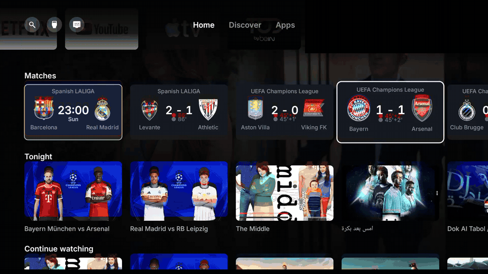
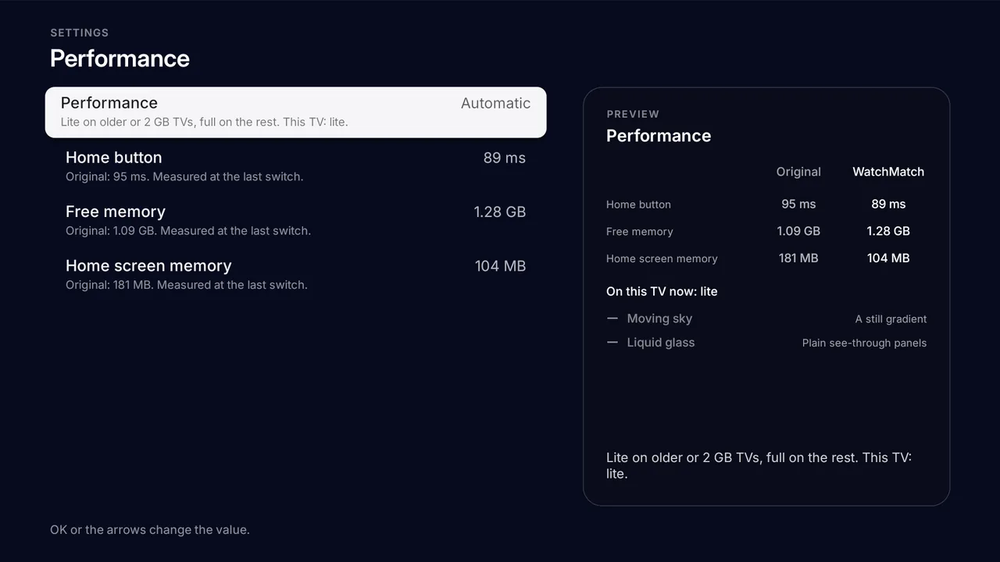
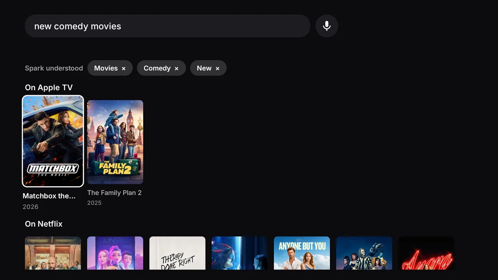

<div align="center">


# WatchMatch

**Your TV's home screen, the way it should have been: fast, quiet, and yours.**

No ads. No promo apps. A search that understands Arabic sentences and an interface that is fully right to left. Live match scores. One button to undo it all.

[](LICENSE)
[](#install)
[](#features)
[](#features)
[](#performance)

[**Website**](https://mamer12.github.io/watchmatch/) · [**Download**](https://github.com/mamer12/watchmatch/releases) · [Install](#install) · [Features](#features) · [Spark](#spark-say-what-you-want-to-watch)



</div>

## Why WatchMatch

You bought a TV to watch things. Then you turned it on and got a wall of sponsored tiles, a home screen that
takes a breath before it answers the Home button, and a handful of "demo" and "store" apps you never asked for.

WatchMatch replaces that screen. It is small, it draws everything itself, and it only shows what is yours: your
apps, your shows, your team's match tonight.

It is not a skin on top of the old screen. It *is* the home screen and the screensaver, and the original is one
press away if you ever miss it.

## Features

| Feature | What you get |
|---|---|
| **Home** | |
| Rows you control | Reorder or hide rows, or start from the Cinema, Sports, Kids or Minimal presets. Pick the apps on the shelf. |
| Discover and Apps | A weekly Top 10, what is popular on your streaming apps, recent apps, all apps and inputs. |
| Remote and phone | On TCL, choose what the Netflix, YouTube and Prime buttons open. Send a link or a search from your phone: home network only, PIN protected. |
| **Search** | |
| Spark | Say or type a sentence in Arabic or English. It becomes filter chips you can remove, and searches TMDB results and the apps installed on your TV. |
| **Sports** | |
| Match Centre | Live scores with crests, a match-day card for your team, a reminder 10 minutes before kick-off over any app, goal alerts and quiet hours. |
| **Look & accessibility** | |
| Arabic, fully right to left | When the TV speaks Arabic the whole interface mirrors: tabs, rows, focus, settings, Top 10 numbers. Follows the TV language, Western (123) or Arabic-Indic (١٢٣) digits, Arabic voice search. |
| Look | Light, dark or by your city's real sunset. Accent colour, 12 or 24 hour clock, Celsius or Fahrenheit. |
| Accessibility | Larger text, high contrast, reduced motion. |
| Settings with live preview | Every setting says what it does and a preview panel shows the effect as you move. |
| **Performance** | |
| Light on the hardware | 1.5 MB APK, one Canvas, Lite mode picked automatically on weak TVs. See [Performance](#performance). |
| **Reliability** | |
| Power-cut proof | Trusted time, retries with backoff, saved rows and durable writes. |
| Watchdog | Goes back to the stock home screen after 3 crashes in 5 minutes. |
| **Privacy & safety** | |
| No ads, no tracking | No accounts, no analytics. Your TMDB and YouTube keys stay on your computer. |
| No root, reversible | Apps are switched off, never uninstalled; picture, sound, inputs and Google services are protected. *Original* undoes everything. |
| **Platforms** | |
| Platforms | Android TV and Google TV (Android 9+). |

## Performance

A home screen is the one app you open a hundred times a day, so it has to feel instant. These are numbers
measured on a 2 GB TCL Android 11 TV, the kind of set that struggles with the stock launcher:

| | WatchMatch | Stock home |
|---|---:|---:|
| Home screen memory | **53 MB** | 69 MB |
| Home button to home screen | **100 ms** | 180 ms |
| APK size | **1.5 MB** | n/a |
| Lite mode | **automatic** on weak TVs | n/a |

How it stays light:

- Everything is drawn by hand on **one Canvas**. No view hierarchy, no layout passes.
- **No allocations while drawing**, so the garbage collector never stutters a frame.
- **Lite mode** is chosen automatically on weak TVs: simpler effects, same layout. You can force Full or Lite in
  *Settings → Performance*, where the app also shows its own measurements against the original.
- No libraries and no Gradle: only the Android SDK.



## Spark: say what you want to watch

Spark is the search box that reads sentences. Press the mic on your remote, or type, in Arabic or English.

| You say | Spark understands |
|---|---|
| `افلام عربيه قديمه` | movies, Arabic, old |
| `new gangster movies` | crime, recent (the last 3 years), movies |
| `مسلسل بريكينج باد` | a series, title "Breaking Bad" |
| `foreign comedy movies` | comedy, non-Arabic, movies |



- Splits your sentence into **filter chips** (type, genre, era, origin) you can remove with one press.
- Searches **TMDB results** (for your streaming apps) and **the apps installed on the TV** at once.
- Words it does not know become the title, so a bare name works too.
- Listens in the language you chose for WatchMatch.
- Knows eras (*new*, *old*, a decade, a year, a range) and origins (Arabic, Turkish, Korean, Indian, Japanese,
  Egyptian, Gulf, American).

Rename it with `spark_name` in `config.properties`. The Match Centre is set on the TV in *Settings → Match Centre*;
first values come from `teams=` and `leagues=` (ESPN's codes such as `uefa.champions`, `eng.1`, `esp.1`, `ksa.1`).
Settings are grouped as **Home screen · Look · Match Centre · Search · Remote Buttons · Screensaver · Accessibility ·
Performance · About**.

## Install

You need a Google TV or Android TV on Android 9 or newer, and a computer on the same Wi-Fi. About ten minutes.

**First, on the TV:** Settings → System → About, press *Android TV OS build* 7 times. Then Settings → System →
Developer options → **USB debugging** on. Note the IP address (Settings → Network & Internet).

### Path 1: with Claude Code (easiest)

```bash
git clone https://github.com/mamer12/watchmatch && cd watchmatch
```

Open [Claude Code](https://claude.com/claude-code) in that folder and say:

> Install WatchMatch on my TV at 192.168.1.50. I live in Baghdad.

It installs the missing tools, builds the app and puts it on the TV. It reads [CLAUDE.md](CLAUDE.md) to do it the
careful way. You do the taps on the TV: accept the debugging prompt (tick *Always allow*), then
*WatchMatch → Home Screen → WatchMatch*.

### Path 2: manual, with adb

1. Tools: JDK 17+, Android command-line tools (build-tools 34, platform android-34) and adb.
   ```bash
   # macOS
   brew install --cask temurin android-commandlinetools android-platform-tools
   sdkmanager "build-tools;34.0.0" "platforms;android-34"
   ```
   On Linux use OpenJDK 17 and Android's tools from your package manager; on Windows use WSL.
2. `./build.sh`. The first run creates `config.properties`: set your city and keys, then run it again.
3. Install:
   ```bash
   adb connect 192.168.1.50:5555
   adb install -r WatchMatch.apk
   ```
4. **TCL TVs only.** TCL blocks background jobs by default, so the switch would never start:
   ```bash
   adb shell "appops set io.watchmatch AUTO_START allow || appops set io.watchmatch APP_AUTO_START allow"
   ```
5. On the TV: *WatchMatch → Home Screen → WatchMatch*.

### Path 3: download a release

Grab `WatchMatch.apk` from
**[Releases](https://github.com/mamer12/watchmatch/releases)** and install with `adb install -r`. Releases are
built without your personal keys, so the trending picks need a TMDB key: build it yourself (path 1 or 2) if you
want those.

## Configure

`./build.sh` copies [`config.example.properties`](config.example.properties) to `config.properties`. These are the
first values; what you change on the TV later (Settings) wins.

| Key | What it does | Default |
|---|---|---|
| `app_name` | The launcher's name on the TV | `WatchMatch` |
| `spark_name` | The smart search's name | `Spark` |
| `tmdb_key` | Free [TMDB](https://www.themoviedb.org/settings/api) key for picks and screensaver photos | empty |
| `tmdb_region` | Two-letter country: which titles are on which app | `US` |
| `youtube_key` | Google API key (YouTube Data API v3) for Continue watching | empty |
| `youtube_client_id`, `youtube_client_secret` | Optional read-only YouTube sign-in: subscriptions and likes | empty |
| `latitude`, `longitude` | Your city, for weather and the sunset | New York |
| `city` | Name on the weather card | `Weather` |
| `name` | Your first name for the greeting | empty |
| `teams`, `leagues` | Match Centre | `leagues=uefa.champions,eng.1,esp.1` |
| `language` | `auto`, `en`, `es`, `pt` or `ar` | `auto` |
| `show_crypto`, `currency` | Binance prices on home and screensaver | `true`, `USD` |
| `temperature` | `C`, `F` or `auto` | `auto` |
| `disable_assistant` | Also switch off Google Assistant (the remote's mic stops working) | `false` |

Digits (Western or Arabic-Indic), clock format, accent, presets and the like live in the TV's Settings.
Without a TMDB key everything works except the trending picks and screensaver photos. Keep `watchmatch.keystore`:
updates must be signed with the same key.

## Sync

Watchme+ can keep your TV, phone and computer in step: **Continue watching** (and where you stopped in each title), **My List**, **ratings** and a few settings (family filter, title language, subtitle language, size, color and style, autoplay). No account: devices pair with an 8-character code. Playing on one device and picking up on another resumes at the same second, and Continue watching shows "Continued from Phone" on the card.

- **Pair:** Watchme+ Settings, *Sync*. On the first device choose *Start syncing on this TV*; on the next choose *Add another device* (the code, a 10-minute countdown and a QR code appear) and enter it there under *Join with a code*. The web app uses the same service, so a phone or computer can join the same way.
- **Leave:** *Disconnect this TV* stops syncing and keeps what is on the TV; *Delete all synced data* removes it from the service (every device keeps its own copy). *Reset Watchme+ data* also unlinks the TV, without deleting anything on the service.
- **Off by default:** the public release build has no sync (its Settings row is hidden). To build with it, put `supabase_url` and `supabase_anon_key` in `config.properties`. Both are public keys (the anon key is public by design and only reaches rows of your own space); never use a service-role key or a database password.
- **How it works:** local first. Changes queue on the TV, go out in the background (progress at most every 15 seconds while playing, the rest at once) and are retried when the network is back; changes from other devices are pulled when Watchme+ or the home screen opens, and every minute while one is showing. The newest change wins. `app/test/io/watchmatch/SyncLiveCheck.java` tests it against the real service.

## Accounts

Watchme+ can also work like Netflix: **sign in with the same email and password on every device** and your profiles, Continue watching, My List and ratings follow you, with no pairing code. A **guest** (the anonymous session, as before) keeps working; **Continue as guest** on the welcome screen is remembered.

- **Welcome:** the first time Watchme+ opens in a build with sync (and again after a sign-out): *Sign in*, *Create account*, *Continue as guest*. The forms use the on-screen keyboard (letters in either case, digits, symbols) with a masked password and *Show password*; passwords need 8 characters. After signing in, *Getting your profiles…* shows while the first sync runs, then *Who's watching?*.
- **Create account** on a guest TV upgrades it in place (same user, same space, nothing moves); with no session it signs up. **Sign in** on a TV that has its own data asks *Add this TV's data to your account?*: *Add* merges (My List is the union, the newest progress wins, profile lists join, deletions stay), *Don't add* clears the TV first; the old guest space is left either way.
- **Settings, Watchme+, Account** (not in a Kids profile): *Signed in as …* or *Guest*, *Sign out* (the data stays in the account; the TV forgets its profiles and lists and shows the welcome screen next time), *Change password*, *Delete account* (the confirm button is pressed twice, 5 seconds apart), and for a guest *Create account* and *Sign in*. Forgot password is done on the website (`site_url` in `config.properties`). *Link a guest device* (the pairing code) stays under Sync, for guests. WatchMatch's *Settings, Watchme+* shows *Account: Signed in as …* (read only).
- **Backend:** Supabase Auth with email and password. For a TV to create or sign in to accounts without a confirmation email, turn off *Confirm email* in the project's Auth settings; deleting an account needs `supabase/migrations/0002_accounts.sql` (in the web app's repository) applied. An account is one user shared by every device, so devices tell their own rows from others' by nothing but their data (`SyncClient.userId()` is null for an account).
- **Sign in with your phone** (device login, like Netflix): the welcome screen's first button (and Settings, Sync, *Sign in with your phone*, or Account, for a guest) shows a QR code (`site_url/?tv=CODE`) and the code in two groups; the phone signs in or creates the account and taps *Approve*, and the TV, polling `check_device_login` every 3 s (6 s after 2 minutes), is moved into the account's space and shows the profile picker. A new code replaces an expired one (10 minutes). The TV is then *Linked to your account* (a guest session in the account's space: no email, no password or delete here; *Sign out of this TV* leaves the space and wipes it). `DeviceLogin` (network, sync thread), `DeviceLoginRules` (pure), `DeviceLoginRulesCheck`.
- **Checks:** `app/test/io/watchmatch/AccountRulesCheck.java` (flows, wire format, merge, errors, sign-out, delete delay, no password kept) and `AccountLiveCheck.java` (against the real project; skips what the project can't do, and cleans up its test users).

## Profiles

Watchme+ has up to 6 profiles, each with its own **Continue watching**, **My List**, **ratings**, tastes and viewing settings (family filter, title language, subtitles, autoplay). Quality, previews, the connection and sync itself belong to the TV, not to a profile. What Watchme+ had saved before profiles becomes the first profile, *Me*; nothing is lost.

- **Who's watching?** appears when Watchme+ opens and there is more than one profile (*Manage profiles, Ask on every start* turns it off: it then reopens the last one). The avatar at the end of the top bar switches profiles or opens *Manage profiles*; WatchMatch's home screen shows the active profile's Continue watching and My List, and *Settings, Watchme+, Profile* shows who it is.
- **Manage profiles:** name (on-screen keyboard), colour, one of 12 avatars, Kids, PIN, delete (optionally with its synced data).
- **Kids profile:** the family filter and *Skip sensitive scenes* are always on; no Sync, Reset or Profiles in its Settings.
- **PIN** (4 to 6 digits, optional per profile): needed to enter that profile; leaving a Kids profile, opening *Manage profiles* or resetting needs the PIN of an adult profile that has one (no PIN set, no prompt). Five wrong tries lock it for 5 minutes. A PIN is only a family lock, not strong security: the hash syncs with the profile.
- **Sync:** the profile list is one settings row, `profiles`; each profile's rows carry its id (`<id>~<key>`, settings as `pref:<id>:<name>`), and rows from before profiles belong to *Me*. Checks: `app/test/io/watchmatch/ProfileRulesCheck.java`.

## Going back to the original home screen

On the TV: *WatchMatch → Home Screen → Original*. The factory home screen, screensaver and every switched-off app
come back as they were. If WatchMatch ever crashes three times in five minutes, it does this by itself.

To remove it for good, switch to *Original* first, then uninstall WatchMatch from Settings → Apps.

## FAQ

**Is it safe?** It never uninstalls anything, protects picture, sound, inputs and Google services, and is fully
undoable. It is open source: read every line.

**Does it need root?** No. It talks to the TV's own ADB over `127.0.0.1` after you allow debugging once.

**Which TVs?** Google TV and Android TV (TCL, Sony, Hisense, Philips, Xiaomi, Chromecast with Google TV, Google TV
Streamer, onn 4K, NVIDIA Shield) on Android 9+. For any other TV, plug in a Google
TV streamer.

**Why does TCL need `appops`?** TCL's `TclAppBoot` blocks background services by default, so the home switch and the
watchdog would never run. The `appops` lines allow them.

**Do I need a TMDB key?** Only for trending picks and screensaver photos. It is free and takes two minutes.

**My TV is another brand.** Open the folder in Claude Code and say *"set it up for my Sony"*: [CLAUDE.md](CLAUDE.md)
tells it how to read your TV and adapt the lists.

## Troubleshooting

The Watchme+ server is picked automatically (the best connection on your network, checked at every start; Settings, Watchme+, shows which one and has a *Re-check* button). To fix it by hand while testing, run `adb shell am start -n io.watchmatch/.HomeActivity --es provider_override el` (`el`, `albox` or `other`; `auto` gives detection back), and `--es parallel_fetch off` turns off the mirror's parallel downloads; restart the app after the second one. `adb logcat -s WatchMatch` says what was picked and why.

## Developers

```bash
./build.sh              # WatchMatch.apk (creates config.properties on first run)
```

Architecture in nine lines:

1. Plain Android, Java 8, minSdk 28, no Gradle, no libraries: aapt2, javac, d8, zipalign, apksigner.
2. `HomeView` draws the home screen by hand on one Canvas; glass and sky are AGSL shaders on Android 13+, with
   fallbacks for 9 to 12.
3. `HomeMode` runs each switch as a background `ModeJob` using `Adb` (the TV's own ADB on 127.0.0.1).
4. `Watchdog` restores the stock home after three crashes in five minutes.
5. `Spark*` parse a sentence into filters and search TMDB and the TV's apps.
6. `Matches` drives Match Centre; `TrustedTime`, `Backoff` and `Durable` keep it steady offline.
7. Settings live in `Settings*` and `Prefs`; what you set on the TV wins over `config.properties`.
8. Names come from config: `build.sh` generates `Config.java` and the string resources from `app_name`
   and `spark_name` (never edit the generated file).
9. Text goes through `Ui.tr(pt, en)` or `Ui.tr(pt, en, es)`, with Spanish in `Spanish.java` and Arabic mirrored.

Contributing: open an issue or a pull request. Keep the code dependency-free, keep 60 fps (no allocations in
`onDraw`), and make sure `./build.sh` ends with `Built WatchMatch.apk`. Add every new string in Portuguese,
English and Spanish. [CLAUDE.md](CLAUDE.md) has the long version, and Claude Code finds its way around easily.

## Credits

- Built with [Claude Code](https://claude.com/claude-code).
- This product uses the TMDB API but is not endorsed or certified by [TMDB](https://www.themoviedb.org/).
- Weather by [Open-Meteo.com](https://open-meteo.com/) (CC BY 4.0). Prices from the [Binance](https://www.binance.com/) public API. Scores from ESPN.
- Icons: [Material Symbols](https://fonts.google.com/icons) (Apache 2.0). Font: [Inter](https://rsms.me/inter/) (SIL OFL 1.1). Coin logos: [cryptocurrency-icons](https://github.com/spothq/cryptocurrency-icons) (CC0).
- Not affiliated with Google, TCL or any streaming service. Names and logos belong to their owners.

Made by [Mustafa Amer](https://github.com/mamer12).

## License

[MIT](LICENSE). Fork it, change it, ship it.
